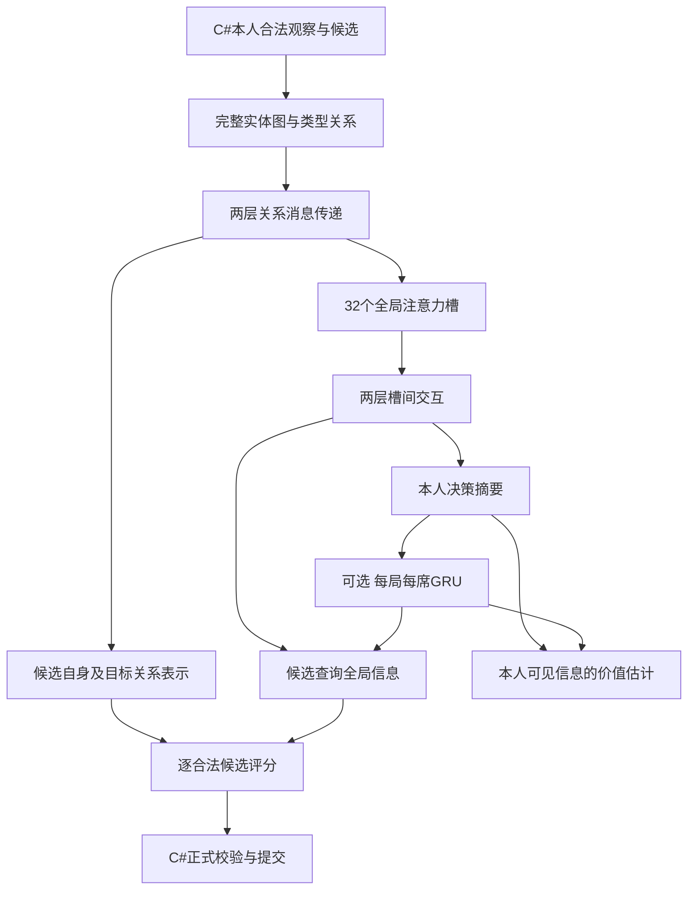

# AI三组模型训练准备（2026-10-14）

在 `feature/ai-training` 工作树新增三组模型、因果序列PPO和独立完整对局评测入口。实现提交 `c0511501`、评测工具提交 `db97b874`。本批进行有上限的接线验证，没有开始长训；结果见[验收记录](../verification/AI三组训练代码验收-2026-10-14.md)。

## 三组模型

| CLI名称 | 结构 | 本批统一96维的参数量 |
|---|---|---:|
| `graph` | 两层关系消息传递，候选直接注意全体节点 | 202066 |
| `entity` | 关系图编码，32个潜在槽，两层槽间注意力，候选查询 | 392146 |
| `entity-gru` | entity加128维GRU，分别影响候选查询和价值估计 | 503698 |

统一表示宽度便于之后对照，但三种网络参数量并不相同。原64维graph仍可用，参数量105810；Python训练入口的graph默认64维，另外两种默认96维。PowerShell入口统一默认96维，复现原尺寸须明确传 `-Hidden 64`。以上不是已通过胜率筛选的最佳尺寸。



所有实体都会被注意力读取，没有按重要性选前K个实体，也不删除合法候选。候选的关系图表示直接连接评分层，绕过全局压缩瓶颈；这提供额外信息路径，不保证神经网络不会忽略重要事实。集合顺序与候选顺序不具有长期行动含义。

GRU每次本人决策更新一次，输入是该次局面的摘要。**完整公开历史和本人获准看到的私有历史仍在实体图中**，不是只保留最近若干步，也不是本批已经完成了历史压缩。当前牌区、持续效果、复活状态、已打出轮次、规则配置等仍明确输入。

## 因果序列训练

`CandidateNetwork.step(graph, candidates, memory)`显式返回下一记忆；模型对象本身不保存席位状态。每次新对局从零记忆开始。训练环境当前只训练一个wasp席位，换边为0/1，其余三席仍为冻结的simple策略；奖励来自学习者所属队伍的最终胜负。尚未接四个学习席位或历史模型对手池。

采样器检查当前和bootstrap观察均来自学习者席位。规则接受实际行动后，才推进一次记忆。为截断估计下一个局面的价值时，试算返回的记忆会被丢弃；不会因此让同一个观察进入记忆两次。

循环PPO保存按整局、按席位归属的轨迹，只打乱轨迹片段的顺序，片段内部按时间前进。每个片段开始前，用当前权重重新读取该局此前全部决策，不计算前缀梯度；片段内执行截断反向传播。默认片段16步，本批短试4步。这样避免优化器更新后沿用旧权重生成的隐藏状态；代价是长局会重复计算前缀，尚未完成高吞吐优化。

GAE在每局边界停止传播。真正结束时下一个价值为0，步数截断时保留下一个本人局面的价值。短试中的截断奖励为0，不能称为平局、胜利或完整对局。

旧的单步教学/防御微调入口仍服务前馈策略；它们不能隐式重置GRU来训练循环模型，调用会明确失败。循环模仿预热需要下一步导出带完整因果前缀、按整场来源分组的教学序列。当前已可使用三种架构分别执行PPO。

## 版本与范围

观察5、行动2、编码器4、静态语义1保持不变；模型格式2、检查点格式2。检查点包含架构、尺寸、规则合同、内容及编码器签名、源码提交和Python文件哈希、训练配置、固定对手、优化器、随机数、种子游标和已完成更新记录。只在对局边界保存，不支持从某个中间决策继续训练。保存的权重先写临时文件再替换。

旧格式、不同架构/尺寸、不同规则合同不自动兼容。续训还检查采样和优化配置及训练器源码文件哈希；显式迁移不属于本批。评测结果另存并绑定检查点SHA256。

共享规则、GameView、Command、存档格式、网络与GameScreen均无修改。C#仍是唯一规则权威。默认规则7水晶生命/3推进阈值；`--life`、`--marks`会先建立对应C#规则包，再获取准确合同。新配置需要独立训练/评测，并非旧模型自动泛化。

Q-09、U-017、未来地图标志物和四席环境等既有语义边界保留；`complete_information=false`未改。没有因选择新网络而放宽信息隔离或容量检查。

## 启动

在 `Goa2V1-ai-training` 执行。沿用已有 `.venv-ai` 的PyTorch 2.5.1+cu118，不需要安装Mamba、Triton或更改驱动。

先运行回归：

```powershell
.venv-ai/Scripts/python.exe -m unittest discover -s ai/trainer -p 'test_*.py' -v
```

一次有上限的训练接线试验，含初始/最终的固定种子换边评测：

```powershell
./tools/run-ai-training.ps1 -Architecture entity-gru -Hidden 96 -Latents 32 -MemoryDim 128 -Iterations 1 -Rollout 16 -Steps 64 -EvalSteps 64 -SequenceLength 4 -BatchSize 8 -Epochs 1 -Seed 17014 -EvalSeed 51014 -MaxMinutes 4 -Output artifacts/ai-training/my-gru-smoke
```

分别改为 `-Architecture graph`、`-Architecture entity`，并使用新的输出目录，即可运行其余两组。64步仅用于接线，预期会截断；正式评测应使用独立较高步数上限。脚本串行构建C#、运行测试（传 `-Test`）、关闭该工具链编译服务器，再执行训练；不会启动Unity。

续训须保留原参数，并在同一命令添加：

```powershell
-Resume artifacts/ai-training/my-gru-smoke/checkpoint-001.pt
```

同时改用新的输出目录。`-Iterations`表示本次增加的更新轮数；种子游标从检查点继续，文件编号也继续递增。不能将 `-Steps`、`-Seed`、片段长度等悄悄改掉后续训。

独立正式评测，不修改权重：

```powershell
.venv-ai/Scripts/python.exe tools/evaluate-ai-checkpoint.py --checkpoint artifacts/ai-training/my-gru-smoke/checkpoint-001.pt --output artifacts/ai-training/my-gru-eval --seed 62014 --pairs 1 --limit 1200 --max-minutes 6 --export-replays
```

`--export-replays`只为已结束对局导出并执行C#场景重放核验。现有Unity场景容量仍为1000条命令，超出会明确失败并保留完整权威日志；不会裁掉后半局。C#导出通过不等于本次Unity Player播放通过。

CPU固定2线程，GPU使用现有运行时并限制本进程分配比例；每个决策/训练片段前检查系统至少保留4GiB内存。超时或异常保留失败JSON、最后策略输入，以及C#独立目录中的权威现场。策略输入和观众/权威记录分开保存。没有自动换种子或改成随机策略续跑。

## 下一阶段

先补足新语义下的因果教学序列和少量可靠动作，再进行相同数据/时间预算的三架构比较。多个训练初始化、留出阵容和规则配置、完整对局胜率及置信区间需要独立评测。随后才考虑历史对手池、长历史计算优化与更长训练。本批结果只决定训练代码是否可运行。
