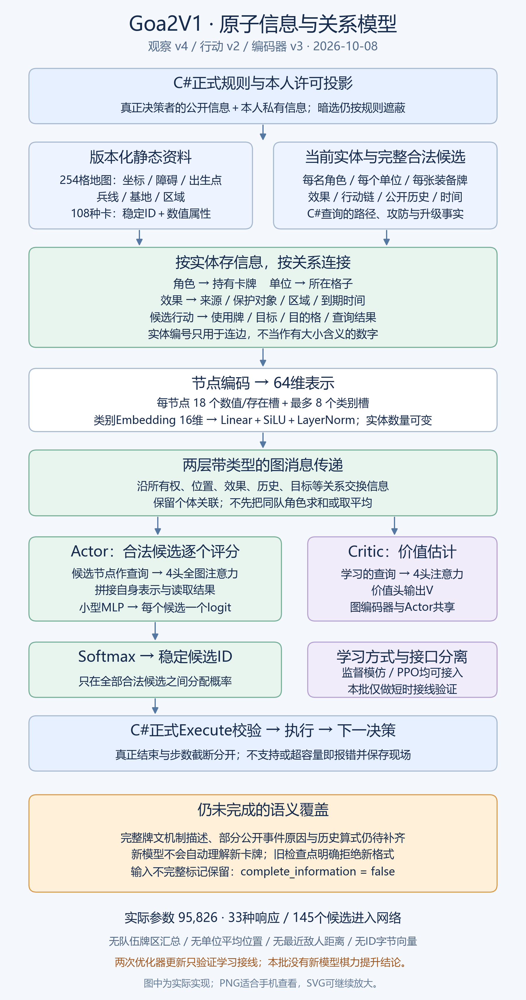
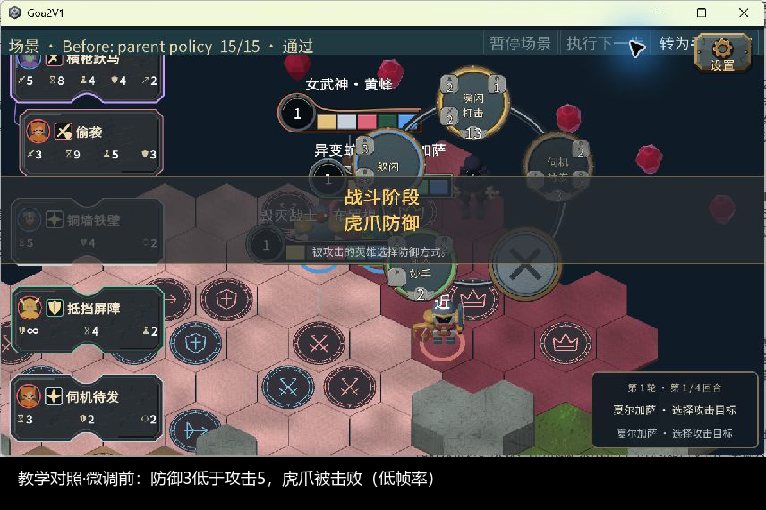
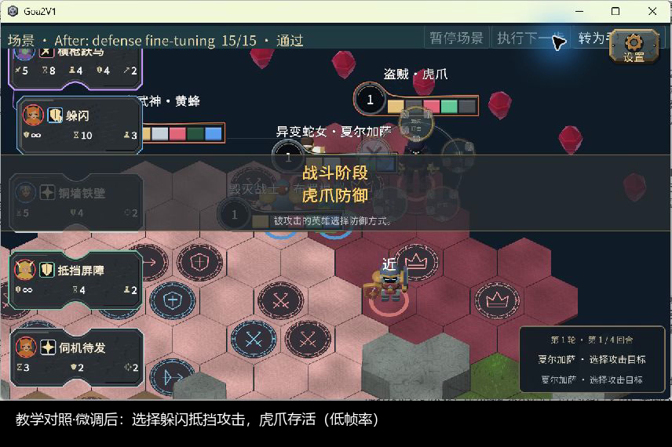

# AI阶段对照：手机查看

本页使用仓库内图片与视频，手机浏览器可打开图片放大；不依赖电脑的C盘路径。10月14日已准备三组模型训练代码；下方游戏录像仍是10月7日旧模型的真实教学对照。

## 10月27日11:46：累计33场完整训练对局

按你新的“继续训练”要求，从第138轮接着跑，**今天10:15:21启动，18:15:21截止**，每30分钟自动巡检。你尚未指定数值token预算；本地训练不消耗对话token，因此暂沿用既有8小时上限，不自动延长。

已从第138轮恢复，23批新增**4,367个样本、500次更新**，到达第161轮，第24批运行中。34次训练尝试中33场完整结束、1场上限截断；92次重复固定评测全部完局，未发现非法命令或异常。旧26,559样本/3,916次更新另计，手机页是发布快照，不是实时计数。

此前截断局270249/换边1的完整现场仍保留，**未判输赢、不计完局**，没有新增截断。训练按原种子序列运行，未重启或降低保护。当前固定换边为1胜1负，独立留出尚未开始，仍无整体变强证据。进程树峰值约1.33GiB，全机平均CPU9.23%，整批12.41环境步/秒。

上轮多数批次被KL变化保护提前结束更新，实际执行次数约为理论的29.7%；已记录这一诊断，尚不能认定为低胜率原因，本轮不偷改恢复配置。[本轮启动核验](AI继续训练启动核验-2026-10-27.md) · [配置和停止边界](../development/AI继续训练与更新利用率检查-2026-10-27.md)。

## 10月27日最终结果：训练结束，尚未证实变强

本轮北京时间**09:18:18正常结束**，早于10:03:24硬截止，巡检已暂停，没有另开训练。从第52轮继续到第138轮，共86批，新增**16,270个学习样本、2,431次参数更新**。

122场训练、344次重复固定评测和8场最终对照全部完整结束；正式完局率100%、截断率0%，未发现非法命令、对局异常或中断。88个短探针截断另计。旧10,289样本/1,485次更新保留，累计26,559样本/3,916次更新。

**新留出换边：恢复起点1胜3负，最终0胜4负；固定回归仍0胜2负。** 四场样本很少，不能认定总体实力升降，但明确没有本轮变强的证据；“起点胜、最终负”的反例也已保留。训练中的23场胜局不替代独立评测。

整批约**11.07环境步/秒**；训练局耗时中位51.44秒、P95为110.32秒。进程树峰值约1.26GiB、全机平均CPU约8.95%，最低采样可用RAM约5.34GiB。仍用CPU两线程，未做GPU训练或修改驱动。

四份最终对局的**C#全命令重放和终态一致性均通过**（611/413/604/576条命令）。本轮没有Unity实机验证，也没有可称为“智力提升”的新录像。下方视频仍是10月7日旧模型的教学对照。

[最终验收与逐局对照](AI续训最终验收-2026-10-27.md) · [四份重放包，约404KiB](ai-resume-20261027/checkpoint138-csharp-replays.zip) · [机器汇总](ai-resume-20261027/final-summary.json) · [历史阶段记录](AI续训启动核验-2026-10-27.md)。

下一步应先分析失败反例与训练信号，再做受控模型对照；更多水晶生命/推进次数需要重新评测，不能假定旧模型自动适应。**本次没有安排下一轮训练。**

## 10月15日最终结果：训练已停，重放导出未通过

本轮于北京时间**17:50:43停止**，完成46批，新增**9,116个决策样本、1,298次优化更新**。71次训练尝试中70场完整结束、1场上限截断，训练完局率98.59%；另184次重复固定评测和8场最终对照均完局。截断未判输赢，未发现非法命令或对局异常。

新留出种子换边：恢复起点第6轮**0胜4负**，最终第52轮**2胜2负**。但原固定种子从2胜0负降至0胜2负，结果分化、样本仍少，**不能认定整体变强**。起点确认为恢复模型，不是最早未训练模型。

最终评测4场结果已经保存，随后第一份674命令对局的重放导出超过60秒，流水线按约定保留失败并退出；其余3份未导出，没有盲目重试。C#权威终态恢复通过，但本轮没有成功的新重放导出、Unity验证或提升录像，原始记录与检查点仍在。

进程树峰值约1.37GiB、全机平均CPU约8.94%，整批有效速度11.23环境步/秒。旧轮1,173样本/187次更新单列，两轮合计10,289样本/1,485次更新。**训练进程已退出，巡检已暂停；未延长预算或开启新训练。**

[最终结果、逐局对照与失败边界](AI断点续训结果与导出失败-2026-10-15.md) · [启动及阶段记录](AI续训启动核验-2026-10-15.md) · [机器可读汇总](ai-resume-20261015/final-summary.json)。

## 10月14日无人值守授权（历史）

用户已授权自动开始训练。新增最多8小时本机任务：实体注意力模型、CPU2线程、1200步完整开局、终局胜负奖励PPO、逐批保存及固定种子换边评测。低内存等待，实际异常保留现场并停止；每30分钟巡检，到期不自动延期。

[配置、停止方式与证据位置](../development/AI无人值守训练-2026-10-14.md)。本页是发布时快照；真实状态及截止时间以本机`status.json`和本对话巡检消息为准，不把排队等待称为已完成学习。最终阶段对照录像须先有真实评测结果。

**10月14日11:12：训练因内存保护提前停止，巡检已暂停。** 已完成6批、1,173个决策样本、187次优化更新。34场正式对局正常结束，另1场资源中断，原始现场和全部检查点保留；本轮不会自行重启。

固定种子换边从初始0胜2负变为第6轮2胜0负，但独立留出评测尚未完成，不能称为整体变强。进程树峰值约1.08GiB、全机平均CPU约9.1%。384命令胜局通过C#重放，另743命令记录导出验证超时；本轮没有新Unity实机验证或录像。[最终结果、失败与后续边界](AI无人值守训练中止报告-2026-10-14.md) · [启动及首次进展（历史）](AI无人值守启动验收-2026-10-14.md)。

## 最新：10月14日三组训练代码可运行

[模型结构、流程图和启动命令](../development/AI三组模型训练准备-2026-10-14.md) · [测试、速度与失败记录](AI三组训练代码验收-2026-10-14.md)

关系图、实体注意力、实体注意力加GRU均已完成真实C#采样与短PPO更新；31项测试通过。GRU记忆按局/席位隔离，完整公开历史继续保留；不匹配的检查点明确拒绝。

新种子换边正式评测两场均完局，0非法/异常/截断，结果0胜2负；483和590命令的完整记录已通过C#重放。只验证链路可用，尚无模型强度提升结论或新Unity录像。

GPU在初始评测触发4GiB系统内存余量保护，未完成学习更新；现场保留。同一种子的10水晶生命/4推进阈值配置已在CPU通过短更新。没有启动长训。

## 10月8日卡牌语义与模型研究

[本次完成内容、输入流程图与模型比较](../development/AI数据语义与模型候选-2026-10-08.md) · [测试和测速](AI数据语义验收-2026-10-08.md)

[108张卡逐牌中文核对](ai-semantics-20261008/catalog/README.md) · [156项输入字段含义](ai-semantics-20261008/validation/input-fields.csv) · [43种机制参数含义](ai-semantics-20261008/catalog/parameters.csv)

已补：卡牌有序步骤、条件/目标/选择者、持续效果含义、本人允许看到的私有历史、公开原因与历史攻击算式。108牌、57步骤、24效果；18项C#、20项Python通过，427场景四席共1708份历史投影通过。正式换边两场全完局、0非法/异常，29.41环境步/秒。

下一步优先对照小型实体注意力/Perceiver式网络与GRU记忆；Mamba-3、Gated DeltaNet、CAT列为研究候选，详情内附论文和依赖核对。没有本轮模型棋力提升或新录像。Q-09/U-017/标志物等既有边界仍明确记录。

## 前一批：10月8日原子输入与关系模型

[新版流程图PNG](ai-entities-20261008/validation/diagram/entity-model.png) · [可放大SVG](ai-entities-20261008/validation/diagram/entity-model.svg) · [九项逐条答复与完整设计](../development/AI原子观察与关系模型重构-2026-10-08.md) · [本批验收](AI原子输入重构验收-2026-10-08.md)

[131个类型化字段的中文含义CSV](ai-entities-20261008/validation/input-fields.csv) · [完整类别/关系/槽位字典](ai-entities-20261008/validation/input-dictionary.json)

逐角色资源、每个英雄/小兵的精确位置、本人及他人牌区、紫卡、持续效果、公开行动链与时间化历史在这一批进入网络。当时尚缺牌文机制和部分事件原因；这些缺口由上方最新一批补充。此处旧图的参数量与字段数属于前一批，最新网络为105810参数，信息完整性仍不作穷尽性承诺。

## 10月7日旧版向量模型（历史）

[模型流程图 PNG](ai-observation-audit-20261007/current-model.png) · [可放大矢量图 SVG](ai-observation-audit-20261007/current-model.svg) · [输入完整性核对](../development/AI可见信息完整性与模型架构-2026-10-07.md)

[为何选择MLP、GAN等候选与逐项输入详解](../development/AI模型选型与逐项输入字典-2026-10-07.md) · [全部2047项输入字典](ai-feature-dictionary-20261007/features.csv)

旧版编码器没有读取持续效果、紫卡身份和公开历史等重要信息。以下旧模型合法对局与防御教学改善不证明这些信息已被理解；旧检查点不能加载新版观察。

## 防御微调前

虎爪选择防御3的偷袭，未挡住攻击5，被击败。

[打开微调前17秒录像](ai-stage4-20261007/defense-video/parent.mp4)

## 防御微调后

同一个公开观察和同一组合法候选，模型选择躲闪，抵挡并存活。

[打开微调后17秒录像](ai-stage4-20261007/defense-video/defense.mp4)

录像无声、约2.6帧/秒真实窗口采集，保存为20fps视频；重复帧没有生成新游戏画面。模型先选出响应，再交给现有Unity重放，未接Unity实时推理。只说明这一防御选择改善，不能证明整局已会玩。

[详细防御验收](AI防御微调验收-2026-10-07.md) · [训练方法与模型原理](../development/AI训练方法与模型原理-2026-10-07.md) · [选牌走位短试](../development/AI选牌走位短试-2026-10-07.md)
